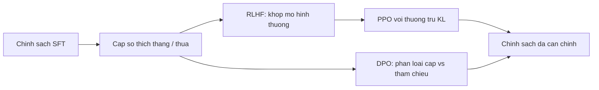

# Căn chỉnh: SFT đến tối ưu sở thích

Tiền huấn luyện dạy mô hình *cấu trúc và phân bố của văn bản*. Tinh chỉnh có giám sát (SFT) dạy mô hình *cách phản hồi một yêu cầu*. **Căn chỉnh** (*alignment*) là bước tiếp theo: trong số nhiều câu trả lời cùng trôi chảy, ưu tiên những câu trả lời được con người (hoặc mô hình đánh giá) xếp hạng cao hơn về mức độ hữu ích, trung thực và an toàn.

Bài này cung cấp **bức tranh tổng thể** về quy trình căn chỉnh trong LLM, không lặp lại toàn bộ phần chứng minh học tăng cường (MDP, hàm lợi thế và PPO đã nằm ở Chương 20–21, còn hệ sinh thái thực tế 2022–2026 nằm ở bài **21-99**).

## 1. Quy trình ba giai đoạn phổ biến

```
LM tiền huấn luyện  →  SFT (minh họa)  →  tối ưu sở thích
```

**Giai đoạn A — Tinh chỉnh có giám sát (SFT).** Thu thập các cặp `(prompt, câu trả lời mẫu)` và tối thiểu hóa hàm mất mát dự đoán token kế tiếp trên phần câu trả lời mẫu (đã giới thiệu ở **26-02**). Về bản chất, đây là học có giám sát trên một tập dữ liệu được chọn lọc kỹ.

**Giai đoạn B — Huấn luyện theo mô hình phần thưởng (RLHF cổ điển).** Thu thập các cặp so sánh $$(y_w, y_l)$$ cho cùng một prompt, trong đó $$y_w$$ là câu trả lời được ưa chuộng hơn (*win*) và $$y_l$$ là câu trả lời kém hơn (*lose*). Trước tiên, huấn luyện mô hình phần thưởng $$r_\phi$$ sao cho $$r_\phi(x, y_w) > r_\phi(x, y_l)$$ (thường bằng hàm mất mát Bradley–Terry / logistic). Sau đó, xem LLM như một chính sách $$\pi_\theta$$ sinh từng token (hành động) và tối đa hóa phần thưởng kỳ vọng kèm **số hạng phạt KL** giữ $$\pi_\theta$$ không lệch quá xa mô hình SFT tham chiếu, tránh việc mô hình sinh ra văn bản bất thường chỉ để đánh lừa $$r_\phi$$.

[Ouyang et al., 2022](https://arxiv.org/abs/2203.02155) (InstructGPT) phổ biến hóa quy trình này với thuật toán PPO (xem thêm Chương 21 và bài **21-99**).

**Giai đoạn C — Tối ưu sở thích trực tiếp không cần vòng lấy mẫu RL.** [Rafailov et al., 2023](https://arxiv.org/abs/2305.18290) (DPO) biến đổi bài toán tối ưu có ràng buộc KL thành một hàm mất mát phân loại trực tiếp trên các cặp $$(y_w, y_l)$$, đối chiếu $$\pi_\theta$$ với mô hình tham chiếu đóng băng $$\pi_{\mathrm{ref}}$$. Do không cần huấn luyện mô hình phần thưởng riêng và không cần vòng lấy mẫu trực tuyến của PPO, DPO trở thành lựa chọn phổ biến trong hệ sinh thái mã nguồn mở giai đoạn 2024–2025 (như thư viện [trl](https://github.com/huggingface/trl)).

Nguyên tắc cốt lõi cần nhớ về vai trò của hai bước:

$$\text{SFT xác định miền hành vi khả dĩ; tối ưu sở thích phân bổ lại xác suất trên miền hành vi đó.}$$

Nếu dữ liệu SFT không chứa các mẫu từ chối phù hợp, trích dẫn nguồn hay gọi công cụ, thì bước tối ưu sở thích chỉ dựa trên tín hiệu so sánh hơn/kém rất khó tự tạo ra những kỹ năng đó.

## 2. Các hàm mục tiêu cốt lõi

Xem LLM là chính sách $$\pi_\theta(y\mid x)$$ sinh chuỗi token $$y$$ ứng với prompt $$x$$. Dưới đây là bốn biểu thức nền tảng thường gặp trong tài liệu (chi tiết chứng minh và các biến thể như IPO, KTO, ORPO có thể xem thêm ở Chương 20–21 và bài **21-99**).

**Gradient chính sách (dạng REINFORCE).** Nhân hàm lợi thế hoặc phần thưởng $$\hat{A}$$ với gradient của log-xác suất:

$$\nabla_\theta J(\theta) \approx \mathbb{E}_{x,y\sim\pi_\theta}\big[\,\hat{A}(x,y)\,\nabla_\theta \log\pi_\theta(y\mid x)\,\big].$$

Với mô hình tự hồi quy, $$\log\pi_\theta(y\mid x) = \sum_t \log\pi_\theta(y_t\mid x, y_{<t})$$ — có cùng cấu trúc tổng như hàm mất mát NLL của SFT, nhưng mỗi mẫu được nhân thêm trọng số $$\hat{A}$$ thay vì luôn bằng 1.

**RLHF với số hạng phạt KL.** Sau khi huấn luyện mô hình phần thưởng $$r_\phi$$, hàm mục tiêu chuẩn ([Ouyang et al., 2022](https://arxiv.org/abs/2203.02155)) là:

$$\max_\theta\; \mathbb{E}_{x\sim\mathcal{D},\, y\sim\pi_\theta}\big[r_\phi(x,y)\big] - \beta\,\mathrm{KL}\big(\pi_\theta(\cdot\mid x)\,\|\,\pi_{\mathrm{ref}}(\cdot\mid x)\big).$$

Số hạng KL ngăn chính sách mới bị sụp đổ hoặc khai thác kẽ hở của $$r_\phi$$ (*reward hacking*); thông thường $$\pi_{\mathrm{ref}}$$ là bản lưu sau SFT.

**Mục tiêu cắt ngưỡng của PPO.** PPO ([Schulman et al., 2017](https://arxiv.org/abs/1707.06347)) tối đa hóa hàm thay thế có cắt ngưỡng trên tỉ số xác suất $$r_t(\theta) = \pi_\theta(a_t\mid s_t)/\pi_{\mathrm{old}}(a_t\mid s_t)$$:

$$L^{\mathrm{CLIP}}(\theta) = \mathbb{E}\Big[\min\big(r_t(\theta)\,\hat{A}_t,\; \mathrm{clip}(r_t(\theta), 1-\varepsilon, 1+\varepsilon)\,\hat{A}_t\big)\Big].$$

Trong bối cảnh LLM, hành động $$a_t$$ là token tại bước $$t$$ và trạng thái $$s_t$$ là chuỗi tiền tố. InstructGPT sử dụng vòng lặp này, nhưng chi phí triển khai khá cao (cần lấy mẫu trực tuyến, thường phải duy trì thêm mạng giá trị và dễ nhạy siêu tham số).

**DPO (tối ưu sở thích trực tiếp).** [Rafailov et al., 2023](https://arxiv.org/abs/2305.18290) rút gọn bài toán tối ưu có phạt KL về dạng đóng, thu được hàm mất mát phân loại trên các cặp $$(y_w, y_l)$$:

$$\mathcal{L}_{\mathrm{DPO}}(\theta) = -\log\sigma\Big(\beta\log\frac{\pi_\theta(y_w\mid x)}{\pi_{\mathrm{ref}}(y_w\mid x)} - \beta\log\frac{\pi_\theta(y_l\mid x)}{\pi_{\mathrm{ref}}(y_l\mid x)}\Big).$$

Về trực giác, DPO tăng khoảng cách phần thưởng ẩn giữa phản hồi thắng và phản hồi thua, đo bằng tỉ lệ log-xác suất so với mô hình tham chiếu $$\pi_{\mathrm{ref}}$$, mà không cần mô hình $$r_\phi$$ hay vòng *rollout* của PPO.



## 3. Căn chỉnh *không* thay thế những gì?

- **Không thay thế truy hồi thông tin:** Tối ưu sở thích không tự bổ sung dữ kiện thực tế vốn không có trong tiền huấn luyện hoặc ngữ cảnh (xem RAG ở Chương 18-99).
- **Không phải đảm bảo an toàn tuyệt đối:** Dữ liệu phản hồi chỉ mã hóa một chính sách mong muốn chứ không chứng minh độ vững chắc trước mọi đầu vào; tấn công vượt rào (*jailbreak*) và dịch chuyển phân bố vẫn đòi hỏi đánh giá riêng.
- **Không đồng nhất với riêng RL:** RLHF chỉ là một phương pháp cài đặt; DPO, các hàm mất mát so sánh cặp khác hay quy trình SFT chọn lọc kỹ đều thuộc phạm vi căn chỉnh.
- **Khác với chưng cất mô hình:** Chưng cất sao chép hành vi của mô hình giáo viên sang mô hình học sinh nhỏ hơn (**26-05**), còn căn chỉnh thay đổi *hành vi nào* được ưu tiên. Trong thực tế, người ta thường căn chỉnh mô hình lớn trước rồi mới chưng cất xuống phiên bản nhỏ hơn.

## 4. Tóm tắt quy trình trên một prompt mẫu

Với một prompt $$x$$:

1. Lấy mẫu (hoặc biên soạn) hai câu trả lời $$y_1, y_2$$ từ mô hình SFT.
2. Người đánh giá (hoặc mô hình đánh giá) chọn cặp ưu tiên $$y_w \succ y_l$$.
3. *Nhánh RLHF:* huấn luyện mô hình phần thưởng $$r_\phi$$, sau đó tối ưu $$\pi_\theta$$ bằng PPO với phần thưởng hiệu chỉnh $$r_\phi - \beta \log(\pi_\theta/\pi_{\mathrm{ref}})$$.
4. *Nhánh DPO:* tăng $$\log\pi_\theta(y_w\mid x)$$ tương đối so với $$\log\pi_\theta(y_l\mid x)$$, chuẩn hóa theo các giá trị tương ứng của $$\pi_{\mathrm{ref}}$$.

## 5. Kết nối với các bài liên quan

- **Chương 20–21:** Nền tảng trạng thái, hành động, lợi tức và PPO.
- **Bài 21-99:** RLHF, DPO và GRPO cho mô hình suy luận.
- **Bài 26-04:** Tối ưu chi phí phục vụ chính sách đã căn chỉnh.
- **Bài 26-05:** Thu nhỏ mô hình đã căn chỉnh qua chưng cất mà không phải thu thập lại toàn bộ dữ liệu sở thích.

## Đọc thêm

- Ouyang et al., 2022. [Training language models to follow instructions with human feedback](https://arxiv.org/abs/2203.02155) (InstructGPT / RLHF + PPO).
- Schulman et al., 2017. [Proximal Policy Optimization Algorithms](https://arxiv.org/abs/1707.06347).
- Rafailov et al., 2023. [Direct Preference Optimization](https://arxiv.org/abs/2305.18290).
- Tài liệu tham khảo mở rộng: [Alisa’s Book of LLMs](https://alisawuffles.notion.site/alisa-s-book-of-llms).

## Điểm chính cần nhớ

- Quy trình căn chỉnh phổ biến gồm SFT rồi tối ưu lại phân bố phản hồi theo sở thích.
- Ba công thức cốt lõi cần nắm: gradient chính sách $$\hat{A}\nabla\log\pi$$, mục tiêu RLHF (phần thưởng trừ $$\beta\,\mathrm{KL}$$ so với mô hình tham chiếu) và hàm mục tiêu cắt ngưỡng của PPO.
- DPO chuyển cùng bài toán tối ưu có phạt KL thành hàm mất mát logistic trực tiếp trên cặp $$(y_w, y_l)$$, không cần mô hình phần thưởng riêng lúc huấn luyện.
- Năng lực và tri thức đến từ dữ liệu (cùng công cụ); căn chỉnh giúp ưu tiên những hành vi mong muốn trong số năng lực đã có.

## Video tham khảo

- **Xem trước** [Reinforcement Learning with Human Feedback (RLHF), Clearly Explained!!!](https://www.youtube.com/watch?v=qPN_XZcJf_s) — StatQuest with Josh Starmer, tiếng Anh. Trình bày bức tranh ba giai đoạn tiền huấn luyện, SFT và tối ưu sở thích.
- [Direct Preference Optimization (DPO) - How to fine-tune LLMs directly without reinforcement learning](https://www.youtube.com/watch?v=k2pD3k1485A) — Luis Serrano Academy, tiếng Anh. Giải thích trực quan hàm mục tiêu DPO và lý do không cần vòng lặp RL.
- [Reinforcement Learning from Human Feedback (RLHF) Explained](https://www.youtube.com/watch?v=T_X4XFwKX8k) — IBM Technology, tiếng Anh. Tóm tắt cơ chế RLHF dùng mô hình phần thưởng để đối chiếu với DPO.
