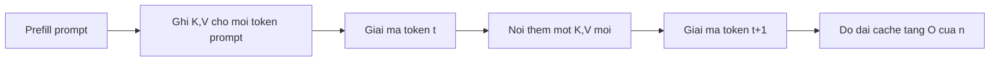
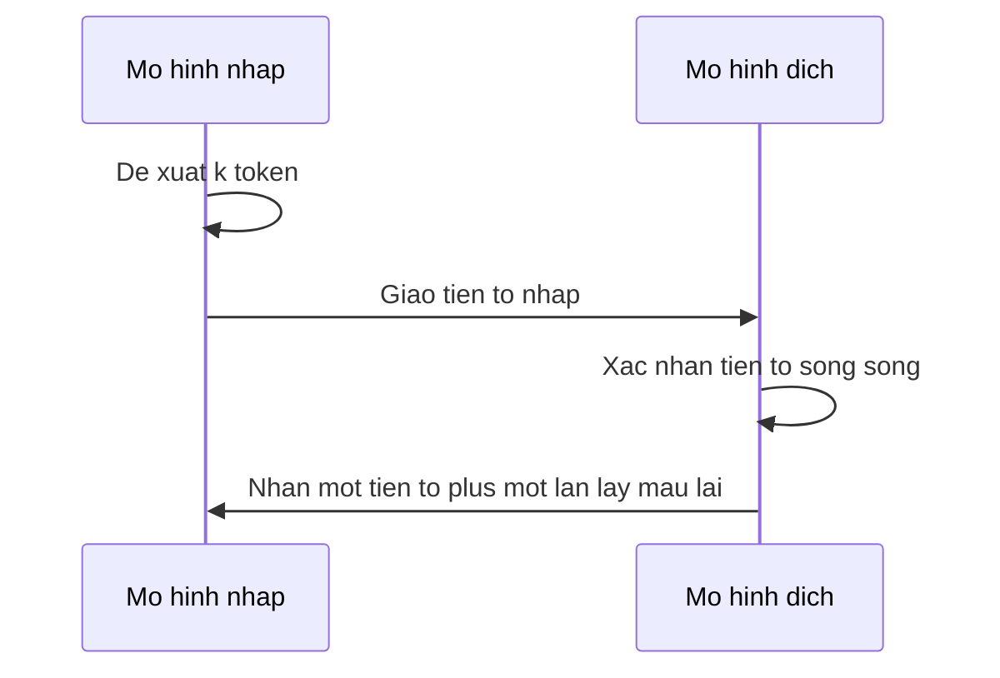

Tại sao khi bạn gửi một văn bản dài 2.000 từ cho LLM, nó chỉ mất chưa đầy 1 giây để "đọc" hết toàn bộ văn bản đó, nhưng sau đó lại phải mất tới 5 giây chỉ để "viết" ra 200 từ trả lời? Bí mật nằm ở hai pha vật lý hoàn toàn trái ngược nhau trên GPU: **Prefill** (nghẽn tính toán — compute-bound, chạy song song toàn bộ prompt) và **Decode** (nghẽn băng thông bộ nhớ — memory-bandwidth-bound, sinh từng token một). Bài học này mở khóa toàn bộ nghệ thuật phục vụ LLM tốc độ cao.

## Bản đồ kiến thức nền: Bốn trụ cột của Phục vụ và Hiệu năng suy luận LLM

- **Hai pha Prefill vs. Decode và hai thước đo TTFT / TPOT:** Tách biệt *Time-To-First-Token* (độ trễ pha Prefill) với *Time-Per-Output-Token* (tốc độ sinh từng token ở pha Decode) để chẩn đoán đúng nút cổ chai phần cứng.
- **KV Cache, PagedAttention và Continuous Batching:** Tái sử dụng vector Key/Value của các token cũ tránh tính lại bậc hai, quản lý VRAM không phân mảnh theo trang (kiểu hệ điều hành), và chèn/nhả yêu cầu ở cấp độ từng token.
- **Chiến lược giải mã lấy mẫu (Temperature, Top-$$k$$, Top-$$p$$ Nucleus):** Kiểm soát trực tiếp sự đánh đổi giữa tính xác định chính xác (code, toán) và độ sáng tạo đa dạng (viết lách).
- **Speculative Decoding và Disaggregated Serving:** Dùng mô hình nháp kiểm định song song nhiều token một lượt để bẻ gãy nút cổ chai băng thông của pha Decode.

### Khung giải thích (nên đọc chậm): Tính tay tác động của Nhiệt độ $$T$$ và lọc Top-$$p$$ (Nucleus Sampling) lên phân phối token

Giả sử tại bước sinh hiện tại, 4 token ứng viên có logit là $$\mathbf{z} = [4{,}0,\; 3{,}0,\; 2{,}0,\; 1{,}0]$$.

1. **Ở nhiệt độ chuẩn $$T = 1{,}0$$:**
   - Trừ cực đại $$4{,}0$$ được $$[0, -1, -2, -3]$$ → hàm mũ $$[1{,}000,\; 0{,}368,\; 0{,}135,\; 0{,}050]$$ (tổng $$1{,}553$$).
   - Xác suất: $$[64{,}4\%,\; 23{,}7\%,\; 8{,}7\%,\; 3{,}2\%]$$.
   - **Áp dụng Top-$$p = 0{,}85$$:** Tổng xác suất tích lũy sau token 1 là $$64{,}4\% < 85\%$$; sau token 2 là $$64{,}4\% + 23{,}7\% = 88{,}1\% \ge 85\%$$ → **chỉ giữ 2 token đầu**, chuẩn hóa lại thành $$[73{,}1\%,\; 26{,}9\%]$$ (cắt bỏ hoàn toàn đuôi nhiễu 2 token cuối).
2. **Khi giảm nhiệt độ $$T = 0{,}5$$ (làm nhọn phân phối cho bài toán code/toán):**
   - Logit chia $$0{,}5$$ thành $$[0, -2, -4, -6]$$ → hàm mũ $$[1{,}000,\; 0{,}135,\; 0{,}018,\; 0{,}002]$$ (tổng $$1{,}155$$).
   - Xác suất token đứng đầu vọt từ $$64{,}4\%$$ lên **$$86{,}6\%$$** — mô hình trở nên tập trung và ít sinh từ ngẫu nhiên sai lệch hơn hẳn!

# Phục vụ và hiệu năng cho LLM

Một mô hình decoder đã qua tiền huấn luyện, SFT và căn chỉnh vẫn có chi phí vận hành cao **trên từng token sinh ra**. Trong khi huấn luyện là khoản chi một lần (hoặc theo chu kỳ dài), chi phí phục vụ suy luận tăng liên tục theo số lượng người dùng. Bài này trình bày các kỹ thuật tối ưu phục vụ nên cân nhắc trước khi quyết định huấn luyện một mô hình học sinh qua chưng cất.

Phần toán học nền tảng về nén mô hình nằm ở **Chương 23**, còn các phương pháp lượng tử hóa riêng cho LLM (GPTQ, AWQ, GGUF) nằm ở **23-99**. Ở đây, trọng tâm là phân tích *yếu tố nào gây tốn kém khi giải mã và khi nào chưng cất là bước tiếp theo hợp lý*.

## 1. Hai pha suy luận: Prefill và Decode

Quá trình sinh tự hồi quy gồm hai pha có đặc tính tính toán khác nhau:

**Pha Prefill:** Toàn bộ prompt đầu vào (gồm *system prompt*, lịch sử hội thoại, câu hỏi người dùng và văn bản truy hồi) được xử lý song song. Mô hình tính *attention* trên toàn bộ prompt một lần và lưu kết quả vào **KV-cache**: với mỗi tầng và mỗi token đầu vào, các vectơ *key* và *value* được giữ lại trong bộ nhớ.

**Pha Decode:** Mô hình sinh từng token mới một cách tuần tự. Nếu không có *cache*, mỗi bước $$t$$ sẽ phải tính lại *attention* từ đầu cho toàn bộ tiền tố (độ phức tạp khoảng $$O(t^2)$$). Nhờ KV-cache, mỗi bước chỉ cần nối thêm một cặp $$k, v$$ mới và tính *attention* với tiền tố đã lưu (chi phí *attention* khoảng $$O(t)$$ mỗi token mới, cộng thêm tầng MLP).

Các hệ thống phục vụ như vLLM, SGLang hay llama.cpp tập trung tối ưu đúng ba việc: quản lý đồng thời nhiều KV-cache, gom phép nhân ma trận hiệu quả và che giấu độ trễ truy xuất bộ nhớ (I/O).

Trong pha *decode*, **dung lượng và băng thông bộ nhớ** thường là nút thắt lớn hơn cả FLOPs. Dung lượng KV-cache cho một chuỗi có độ dài $$L$$ xấp xỉ:

$$\mathrm{bytes} \approx 2 \cdot L \cdot n_{\mathrm{layers}} \cdot n_{\mathrm{kv\_heads}} \cdot d_{\mathrm{head}} \cdot b$$

trong đó hệ số 2 ứng với *key* và *value*, còn $$b$$ là số byte cho mỗi phần tử (kỹ thuật *grouped-query attention* giúp giảm $$n_{\mathrm{kv\_heads}}$$). Vì vậy, độ dài cửa sổ ngữ cảnh không chỉ là bài toán chất lượng mà còn là bài toán chi phí hạ tầng trực tiếp.

Lưu ý phân biệt vai trò của hai tối ưu phổ biến: GQA / MQA (**26-07**, **07-99**) trực tiếp giảm kích thước KV-cache qua việc giảm $$n_{\mathrm{kv\_heads}}$$, trong khi FlashAttention **không** làm nhỏ KV-cache mà giảm lượng truyền tải bộ nhớ khi tính *attention* trên cache đó (chia khối kết hợp *online softmax*, xem **26-01** và **26-07**). Phần ước lượng FLOPs và bộ nhớ chi tiết nằm ở bài **26-07**.

## 2. Gom batch liên tục và đóng gói chuỗi

Mỗi bước *decode* đơn lẻ thực chất là một phép nhân ma trận dạng mảnh (batch = 1, độ dài chuỗi = 1, nhưng ma trận trọng số rất lớn), nên không tận dụng hết năng lực tính toán song song của GPU. **Continuous batching** (gom batch liên tục theo từng bước giải mã, đặc trưng của vLLM) cho phép nạp ngay yêu cầu mới vào vị trí của yêu cầu vừa kết thúc thay vì chờ cả lô tĩnh hoàn thành. Tương tự ở pha huấn luyện, **đóng gói chuỗi** (*sequence packing*) ghép nhiều văn bản ngắn vào cùng một cửa sổ kèm mặt nạ chặn *attention* chéo giữa các văn bản để không lãng phí tính toán vào *padding*.

Ngoài ra, phần *prefill* của *system prompt* dùng chung giữa nhiều người dùng có thể tính một lần rồi tái sử dụng qua **prefix caching** (lưu đệm tiền tố).

## 3. Chiến lược lấy mẫu: Nhiệt độ, top-$$k$$ và top-$$p$$

Quá trình giải mã không nhất thiết luôn chọn token có xác suất cao nhất ($$\arg\max$$). Từ vectơ logit $$z$$, phân bố điều chỉnh theo nhiệt độ $$T$$ là:

$$p_i^{(T)} = \frac{\exp(z_i / T)}{\sum_j \exp(z_j / T)}.$$

Khi $$T \to 0$$, phân bố tiến về giải mã tham lam; $$T = 1$$ giữ nguyên phân bố đã học; $$T > 1$$ làm phẳng phân bố (tăng tính đa dạng nhưng cũng dễ sinh nội dung lạc đề hơn). **Top-$$k$$** chỉ giữ lại $$k$$ token có logit cao nhất rồi chuẩn hóa lại xác suất. **Nucleus / top-$$p$$** ([Holtzman et al., 2020](https://arxiv.org/abs/1904.09751)) giữ lại *tập nhỏ nhất* các token có tổng xác suất tích lũy đạt ít nhất $$p$$ rồi chuẩn hóa lại. Nói ngắn gọn, nhiệt độ điều chỉnh *hình dạng* phân bố, còn *top-k* / *top-p* giới hạn *tập ứng viên hợp lệ*; thực tế thường kết hợp theo thứ tự: chia logit cho $$T$$, lọc theo *top-k*/*top-p*, rồi lấy mẫu.

Cần phân biệt nhiệt độ $$T$$ lúc giải mã với nhiệt độ $$T$$ trong chưng cất tri thức (**26-05**): cùng công thức toán học nhưng mục đích khác nhau (điều chỉnh độ đa dạng đầu ra so với làm mềm phân bố mục tiêu của mô hình giáo viên).

## 4. Speculative Decoding (mô hình nháp và xác nhận)

[Leviathan et al., 2023](https://arxiv.org/abs/2211.17192) (cùng các nghiên cứu song song) dùng một mô hình **nháp** (*draft model*) nhỏ, chạy nhanh để đề xuất trước $$k$$ token liên tiếp, sau đó mô hình **đích** (*target model*) lớn kiểm tra toàn bộ tiền tố đó trong một lượt lan truyền xuôi song song. Các token phù hợp với phân bố của mô hình đích được chấp nhận ngay; tại vị trí bất đồng đầu tiên, hệ thống lấy mẫu lại từ phân bố hiệu chỉnh của mô hình đích và bỏ phần nháp phía sau. Khi cài đặt đúng, phân bố đầu ra vẫn **giữ nguyên chính xác** như mô hình đích, đồng thời giảm số lượt gọi tuần tự của mô hình lớn.

*Speculative decoding* là kỹ thuật tối ưu ở tầng *phục vụ*, không tạo ra một mô hình học sinh mới. Nếu bài toán thực sự cần một kiến trúc gọn nhẹ hơn, cần chuyển sang chưng cất (**26-05**).

## 5. Lượng tử hóa: Bước tối ưu chi phí thấp đầu tiên

Giảm độ chính xác trọng số từ 32-bit xuống 16-bit, rồi 8-bit hoặc 4-bit giúp giảm mạnh dung lượng bộ nhớ và cải thiện tốc độ pha *decode* (vốn bị giới hạn bởi băng thông bộ nhớ). Các phương pháp thực dụng cho mô hình 7B–70B như GPTQ, AWQ và GGUF đã được giới thiệu ở **23-99**.

Lượng tử hóa **không** huấn luyện lại mô hình mới mà chỉ biểu diễn xấp xỉ cùng bộ trọng số $$\theta$$ bằng ít bit hơn. Nên ưu tiên lượng tử hóa khi:

- Bạn sở hữu hoặc có quyền sử dụng hợp lệ bản trọng số gốc.
- Mức suy giảm chất lượng sau kiểm thử nằm trong ngưỡng chấp nhận được.
- Mục tiêu là giữ hành vi tương tự với mức tiêu thụ RAM/VRAM thấp hơn (trên máy cá nhân, một GPU hoặc thiết bị biên).

Nếu lượng tử hóa 4-bit vẫn chưa đáp ứng yêu cầu độ trễ hay chi phí, giải pháp tiếp theo là giảm kích thước kiến trúc, dùng mô hình thưa kiểu MoE (**23-99**) hoặc huấn luyện một **mô hình học sinh**.

## 6. Các đòn bẩy tối ưu khác trước khi chưng cất

- **Cache tiền tố (*prefix caching*):** Tái sử dụng kết quả *prefill* cho các *system prompt* dùng chung.
- **Truy hồi thay cho ngữ cảnh quá dài:** Đưa toàn bộ tài liệu lớn vào cửa sổ $$L$$ thường chậm và kém hiệu quả hơn kết hợp truy hồi (RAG, **18-99**).
- **Adapter (LoRA / QLoRA):** Phục vụ nhiều tác vụ chuyên biệt trên cùng một mô hình nền thay vì nhân bản toàn bộ trọng số (xem bài tùy chọn Chương 15).
- **Ước lượng định lượng:** Khi cần tính số tham số $$N$$, kích thước giá trị kích hoạt hay ngân sách $$C \approx 6NT$$, dùng các công thức ở bài **26-07** thay vì ước đoán cảm tính.

Tất cả các kỹ thuật trên giúp chạy mô hình giáo viên rẻ hơn mà chưa thay đổi kiến trúc mô hình.

## 7. Khi nào nên chuyển sang chưng cất?

Nên cân nhắc chưng cất (**26-05**) khi đáp ứng ít nhất một trong các điều kiện sau:

1. **Cần thu nhỏ kiến trúc thực sự:** Lượng tử hóa không thể giảm số tầng hay độ rộng; muốn chuyển từ mô hình 70B xuống 7–8B (hoặc cỡ di động) cần huấn luyện một bộ tham số $$\theta$$ mới.
2. **Cần phiên bản sản phẩm chi phí thấp hơn** có hành vi tương đương trên miền tác vụ mục tiêu, sử dụng mô hình giáo viên mà bạn có quyền huấn luyện từ đó.
3. **Cần tinh chỉnh nhiều mô hình chuyên biệt:** Chưng cất một mô hình học sinh tổng quát một lần rồi gắn các *adapter* LoRA riêng cho từng tác vụ.
4. **Có quyền truy cập hộp trắng** vào mô hình giáo viên và muốn khớp trạng thái ẩn hoặc phân bố token, không chỉ văn bản đầu ra.

**Lưu ý thực hành:** Không nên vội triển khai chưng cất trước khi đã thử lượng tử hóa 4-bit, kiểm soát độ dài ngữ cảnh hợp lý và áp dụng *continuous batching*, bởi chưng cất là một dự án huấn luyện đầy đủ trong khi các kỹ thuật phục vụ thường chỉ cần cấu hình triển khai. Đồng thời, chỉ thực hiện chưng cất từ mô hình giáo viên có giấy phép hoặc quyền sử dụng hợp lệ (phân tích chi tiết ở bài **26-05**).

## Đọc thêm

- Leviathan et al., 2023. [Fast Inference from Transformers via Speculative Decoding](https://arxiv.org/abs/2211.17192).
- Holtzman et al., 2020. [The Curious Case of Neural Text Degeneration](https://arxiv.org/abs/1904.09751) (nucleus sampling).
- Kwon et al., 2023. [Efficient Memory Management for Large Language Model Serving with PagedAttention](https://arxiv.org/abs/2309.06180).
- Tài liệu tham khảo mở rộng: [Alisa’s Book of LLMs](https://alisawuffles.notion.site/alisa-s-book-of-llms).

## Điểm chính cần nhớ

- Chi phí pha *decode* gồm MLP và *attention* trên **KV-cache** tăng tuyến tính $$O(n)$$ theo độ dài chuỗi.
- *Continuous batching* và đóng gói chuỗi tối ưu mức sử dụng GPU; *speculative decoding* tăng tốc bằng cơ chế đề xuất–xác nhận song song mà vẫn giữ nguyên phân bố đích.
- Nhiệt độ điều chỉnh hình dạng phân bố $$p$$; *top-k* và *top-p* giới hạn tập token ứng viên.
- Lượng tử hóa, quản lý ngữ cảnh và gom batch là nhóm tối ưu nên áp dụng trước (**Chương 23 / 23-99**).
- Chưng cất dành cho trường hợp cần một mạng *nhỏ hơn, có bộ tham số mới* học lại hành vi của mô hình giáo viên.

## Video tham khảo

- **Xem trước** [Faster LLMs: Accelerate Inference with Speculative Decoding](https://www.youtube.com/watch?v=VkWlLSTdHs8) — IBM Technology, tiếng Anh. Giải thích trực quan cơ chế đề xuất–xác nhận của *speculative decoding*.
- [How LLMs survive in low precision | Quantization Fundamentals](https://www.youtube.com/watch?v=qoQJq5UwV1c) — Julia Turc, tiếng Anh. Trình bày nền tảng lượng tử hóa — bước tối ưu phục vụ chi phí thấp đầu tiên.
- [Let's build GPT: from scratch, in code, spelled out.](https://www.youtube.com/watch?v=kCc8FmEb1nY) — Andrej Karpathy, tiếng Anh. Có phần cài đặt lấy mẫu theo nhiệt độ để đối chiếu trực tiếp với *top-k* và *top-p* trong bài.
