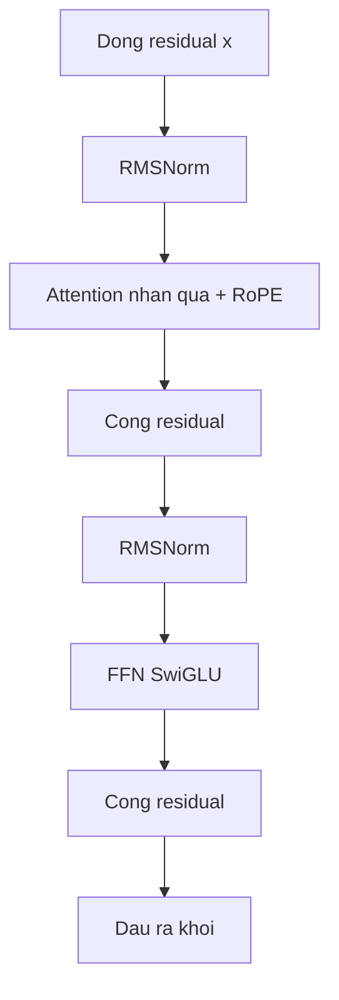
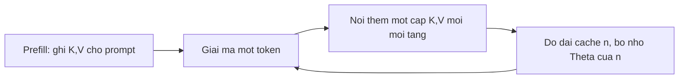
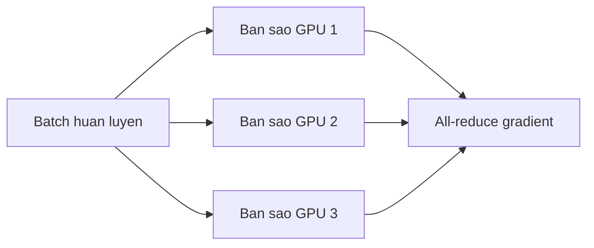
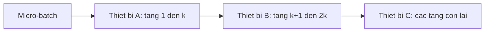
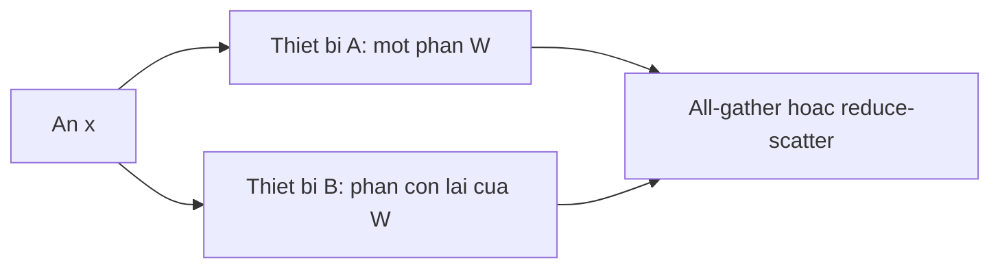

# Nội tại decoder hiện đại và hạch toán chi phí

Chương 08 đã trình bày kiến trúc Transformer năm 2017. Bài này đi vào **cấu trúc khối decoder thực tế** trong các mô hình giai đoạn 2024–2026: chuẩn hóa trước bằng RMSNorm, *attention* nhân quả kết hợp RoPE, mạng truyền thẳng SwiGLU và KV-cache khi giải mã. Đồng thời, bài cung cấp **các công thức ước lượng định lượng** thường dùng trong kỹ thuật hệ thống và phỏng vấn: đếm số tham số, ước lượng bộ nhớ kích hoạt, FLOPs huấn luyện và bộ nhớ suy luận.

Nền tảng đại số của Transformer năm 2017 vẫn giữ nguyên; điểm thay đổi nằm ở cách đóng gói thành phần và tối ưu chi phí. Chi tiết từng thành phần riêng lẻ có thể xem thêm ở **02-99** (SwiGLU / RMSNorm), **08-01** (Transformer gốc) và **07-99** (*attention* hiệu quả); bài này ghép toàn bộ thành một ngăn xếp decoder hoàn chỉnh.

## 1. Cấu trúc khối decoder hiện đại

Một tầng trong các mô hình họ Llama vẫn tuân theo cấu trúc “trao đổi thông tin qua *attention*, sau đó xử lý theo vị trí bằng FFN” với kết nối phần dư (*residual connection*) bọc quanh từng nhánh con và chuẩn hóa đặt trước (*pre-norm*):

### RMSNorm

LayerNorm chuẩn hóa bằng cách trừ trung bình rồi chia cho độ lệch chuẩn. **RMSNorm** ([Zhang & Sennrich, 2019](https://arxiv.org/abs/1910.07467)) bỏ bước trừ trung bình, chỉ chuẩn hóa theo căn bậc hai trung bình bình phương (RMS) kèm hệ số tỉ lệ học được $$\gamma$$ (thường không dùng *bias*):

$$\mathrm{RMSNorm}(x) = \frac{x}{\sqrt{\frac{1}{d}\sum_{i=1}^{d} x_i^2 + \varepsilon}} \odot \gamma.$$

Các họ mô hình như Llama, Gemma và Qwen sử dụng rộng rãi RMSNorm vì tính toán đơn giản hơn, không làm biến đổi giá trị trung bình của luồng phần dư, trong khi vẫn giữ vai trò ổn định biên độ trước các phép nhân ma trận kế tiếp (Chương 09).

### FFN SwiGLU

Trong khi FFN năm 2017 dùng công thức $$\mathrm{ReLU}(x W_1) W_2$$, FFN có cổng hiện đại ([Shazeer, 2020](https://arxiv.org/abs/2002.05202)) có dạng:

$$\mathrm{SwiGLU}(x) = \big(\mathrm{SiLU}(x W_{\mathrm{gate}}) \odot (x W_{\mathrm{up}})\big) W_{\mathrm{down}},$$

với $$\mathrm{SiLU}(z) = z\,\sigma(z)$$ (còn gọi là Swish). Khối này gồm ba ma trận trọng số kết hợp tích theo phần tử (Hadamard). Khi thiết kế, chiều ẩn $$d_{\mathrm{ff}}$$ thường được thu nhỏ lại (ví dụ khoảng $$\frac{8}{3}d$$ thay vì $$4d$$) để tổng **số tham số** tương đương FFN ReLU truyền thống.

### RoPE: Mã hóa vị trí bằng phép quay tương đối

Thay vì cộng vectơ vị trí sin–cos cố định vào *embedding* đầu vào, **RoPE** ([Su et al., 2021/2023](https://arxiv.org/abs/2104.09864)) *quay* từng cặp chiều của vectơ *query* và *key* trong mặt phẳng 2-D theo một góc tỉ lệ với vị trí $$t$$:

$$\begin{pmatrix} q_{2i} \\ q_{2i+1} \end{pmatrix}
\leftarrow
\begin{pmatrix} \cos(t\theta_i) & -\sin(t\theta_i) \\ \sin(t\theta_i) & \cos(t\theta_i) \end{pmatrix}
\begin{pmatrix} q_{2i} \\ q_{2i+1} \end{pmatrix},$$

và áp dụng tương tự cho $$k$$ với các tần số cố định $$\theta_i = \mathrm{base}^{-2i/d}$$. Khi đó, tích vô hướng $$q_t^\top k_s$$ chỉ phụ thuộc vào khoảng cách tương đối $$t - s$$ thay vì từng vị trí tuyệt đối riêng lẻ. Như vậy, **thông tin vị trí tương đối được tích hợp trực tiếp vào điểm số attention** (xem thêm bài **08-99**).

### GQA và MQA: Thu gọn KV-cache

Trong *multi-head attention* (MHA) chuẩn, mỗi đầu *query* có riêng một cặp đầu *key/value*. **Multi-query attention** (MQA, [Shazeer, 2019](https://arxiv.org/abs/1911.02150)) dùng chung duy nhất một cặp *K, V* cho mọi đầu *query*. **Grouped-query attention** (GQA, [Ainslie et al., 2023](https://arxiv.org/abs/2305.13245)) nằm ở giữa: chia $$n_{\mathrm{q}}$$ đầu *query* thành các nhóm dùng chung $$n_{\mathrm{kv}} \ll n_{\mathrm{q}}$$ cặp đầu *key/value*. Công thức tính *attention* không đổi, nhưng kích thước **KV-cache** giảm đi theo tỉ lệ $$n_{\mathrm{kv}} / n_{\mathrm{q}}$$, mang lại lợi ích trực tiếp cho tốc độ phục vụ (**26-04**).

## 2. Cơ chế của FlashAttention

Về mặt toán học, *attention* vẫn là $$\mathrm{softmax}(QK^\top / \sqrt{d})\,V$$. Tuy nhiên, cài đặt thông thường phải tạo và ghi toàn bộ ma trận điểm $$L \times L$$ xuống bộ nhớ chính của GPU (HBM), gây nghẽn băng thông. [Dao et al., 2022](https://arxiv.org/abs/2205.14135) (**FlashAttention**) khắc phục điều này bằng cách **chia khối** (*tiling*) các ma trận $$Q, K, V$$ sao cho vừa vặn bộ nhớ đệm nhanh SRAM trên chip, đồng thời gộp bước softmax với phép nhân $$V$$.

Vì softmax đòi hỏi tổng hàm mũ trên cả hàng, FlashAttention dùng kỹ thuật **softmax trực tuyến** (đã trình bày ở **26-01**): duy trì giá trị cực đại tạm thời $$m$$ và tổng chuẩn hóa $$s$$ của $$e^{z-m}$$ khi duyệt qua từng khối, rồi điều chỉnh lại tỉ lệ tổng có trọng số của $$V$$ mỗi khi $$m$$ thay đổi. Kết quả đầu ra chính xác tương đương về mặt đại số, nhưng lượng đọc/ghi HBM giảm mạnh. Các phiên bản FlashAttention-2 và FlashAttention-3 tiếp tục tối ưu mức độ song song và khai thác phần cứng mới ([Dao, 2023](https://arxiv.org/abs/2307.08691); [Shah et al., 2024](https://arxiv.org/abs/2407.08608); xem thêm **07-99**).

## 3. Hạch toán tham số, FLOPs và bộ nhớ

Các công thức dưới đây cho phép ước lượng nhanh theo thứ tự độ lớn từ các siêu tham số $$n_{\mathrm{layers}}$$, $$d$$, $$V$$ và $$L$$.

### Đếm số tham số (decoder dày đặc)

Bỏ qua các hệ số *bias* nhỏ và kiến trúc MoE:

$$
\begin{aligned}
N_{\mathrm{embed}} &\approx 2\, V d
\quad \text{(bảng nhúng + đầu LM tách riêng; chỉ còn } Vd \text{ nếu chia sẻ trọng số)}, \\
N_{\mathrm{attn}} &\approx n_{\mathrm{layers}}\big( d\cdot d_{\mathrm{q}} + 2\, d\cdot d_{\mathrm{kv}} + d_{\mathrm{q}}\cdot d \big), \\
N_{\mathrm{ffn}} &\approx n_{\mathrm{layers}}\cdot 3\, d\, d_{\mathrm{ff}}
\quad \text{(SwiGLU: gate, up, down)}.
\end{aligned}
$$

Với kiến trúc nhiều đầu, $$d_{\mathrm{q}} = n_{\mathrm{q}} d_{\mathrm{head}}$$ và $$d_{\mathrm{kv}} = n_{\mathrm{kv}} d_{\mathrm{head}}$$. Khi dùng MHA chuẩn ($$n_{\mathrm{kv}} = n_{\mathrm{q}}$$), số tham số *attention* vào khoảng $$4 n_{\mathrm{layers}} d^2$$; với GQA, hai khối chiếu *K, V* thu gọn thành $$2 d \cdot d_{\mathrm{kv}}$$. Bảng nhúng chỉ chiếm tỉ trọng lớn khi $$d$$ nhỏ hoặc $$V$$ rất lớn; ở quy mô LLM thông thường, các tầng Transformer chiếm phần lớn tổng tham số.

### Ước lượng bộ nhớ giá trị kích hoạt khi huấn luyện

Các giá trị kích hoạt từ lượt lan truyền xuôi cần lưu lại cho lan truyền ngược tỉ lệ với:

$$n_{\mathrm{layers}} \times B \times L \times d$$

cộng thêm các ma trận *attention* nếu không tính lại. Kỹ thuật *activation checkpointing* (tính lại kích hoạt ở lượt ngược) đánh đổi thêm FLOPs để giảm mạnh dung lượng bộ nhớ này. Đây là lý do **kích thước micro-batch** và **độ dài chuỗi** thường chạm trần VRAM trước cả bản thân bộ trọng số.

### Ước lượng FLOPs

Một phép nhân ma trận trọng số kích thước $$n \times m$$ với $$L$$ token tốn khoảng $$2 n m L$$ FLOPs (mỗi cặp nhân–cộng tính là 2 phép toán dấu phẩy động). Cộng gộp trên toàn bộ mô hình, quy tắc bậc nhất phổ biến ([Kaplan et al., 2020](https://arxiv.org/abs/2001.08361)) là:

$$
\begin{aligned}
C_{\mathrm{fwd}} &\approx 2\, N_{\mathrm{params}}\, T, \\
C_{\mathrm{bwd}} &\approx 2\, C_{\mathrm{fwd}} \approx 4\, N_{\mathrm{params}}\, T, \\
C_{\mathrm{train}} &\approx 6\, N_{\mathrm{params}}\, T,
\end{aligned}
$$

trong đó $$T$$ là tổng số **token** (batch $$\times$$ độ dài chuỗi $$\times$$ số bước). Công thức xấp xỉ này bỏ qua số hạng $$O(L^2 d)$$ của *attention* (chỉ đáng kể khi độ dài chuỗi $$L$$ rất lớn). Lượt lan truyền ngược tốn khoảng gấp đôi lượt xuôi vì mỗi tầng cần một phép nhân ma trận để tính gradient theo đầu vào và một phép nhân để tính gradient theo trọng số (Chương 03).

### Bộ nhớ khi suy luận

Ở chế độ suy luận, hệ thống không cần lưu đồ thị tính toán hay trạng thái bộ tối ưu; bộ nhớ chính gồm trọng số mô hình và KV-cache:

$$\mathrm{mem} \approx \underbrace{N_{\mathrm{params}} \cdot b_{\mathrm{w}}}_{\text{trọng số}} + \underbrace{2 \cdot L \cdot n_{\mathrm{layers}} \cdot n_{\mathrm{kv}} \cdot d_{\mathrm{head}} \cdot b_{\mathrm{kv}}}_{\text{KV-cache}},$$

với $$b_{\mathrm{w}}$$ và $$b_{\mathrm{kv}}$$ là số byte mỗi phần tử (ví dụ 2 byte cho FP16/BF16, 1 byte cho INT8). Số hạng KV-cache **tăng tuyến tính theo độ dài chuỗi $$L$$**: lượng tử hóa trọng số giúp giảm số hạng đầu tiên, còn GQA giúp giảm số hạng thứ hai.

## 4. Định luật mở rộng tối ưu theo tính toán (kiểu Chinchilla)

[Kaplan et al., 2020](https://arxiv.org/abs/2001.08361) chỉ ra rằng trên một dải quy mô rộng, hàm mất mát tiền huấn luyện giảm theo quy luật lũy thừa theo kích thước mô hình, lượng dữ liệu và ngân sách tính toán; trong thiết lập ban đầu của họ, tăng số tham số nhanh hơn số token tỏ ra có lợi hơn. Sau đó, [Hoffmann et al., 2022](https://arxiv.org/abs/2203.15556) (*Training Compute-Optimal Large Language Models*, bài báo **Chinchilla**) thiết kế lại thí nghiệm đồng mức tính toán (*isoFLOP*) và rút ra kết luận khác: **với một ngân sách FLOP huấn luyện cố định, cần tăng số tham số và số token theo tỉ lệ cân đối với nhau**, vì nhiều mô hình lớn trước đó thực chất bị thiếu dữ liệu huấn luyện.

Các điểm cốt lõi cần ghi nhớ:

- Ngân sách huấn luyện $$C \approx 6 N T$$ phải được phân bổ hợp lý giữa kích thước mô hình $$N$$ và lượng dữ liệu $$T$$.
- “Tối ưu tính toán” (*compute-optimal*) nghĩa là chọn cặp $$(N, T)$$ trên cùng đường đồng mức FLOP để đạt *hàm mất mát thấp nhất*, không phải để có mô hình nhiều tham số nhất.
- Trong thiết lập của Hoffmann et al., điểm tối ưu rơi vào khoảng **vài chục token cho mỗi tham số**. Tuy nhiên, nhiều mô hình thực tế sau này chủ động huấn luyện *vượt* ngưỡng dữ liệu này (dùng nhiều token hơn cho một $$N$$ nhỏ hơn) nhằm giảm chi phí phục vụ suy luận lâu dài.
- Trong khi Chương 25 khảo sát rộng các xu hướng mở rộng (kể cả tính toán lúc suy luận ở **25-99**), phần này tập trung vào đánh đổi phân bổ tài nguyên **trong giai đoạn huấn luyện**.

## 5. So sánh RNN / LSTM, Transformer và mô hình không gian trạng thái (SSM)

| Tiêu chí | RNN / LSTM (Ch. 05–06) | Decoder Transformer (Ch. 08, bài này) |
| --- | --- | --- |
| Trạng thái | Một vectơ ẩn $$h_t$$ cập nhật từ $$h_{t-1}$$ | Toàn bộ tiền tố được trộn trực tiếp qua *attention* |
| Song song theo thời gian $$t$$ | Tuần tự: bước $$t$$ phụ thuộc bước $$t-1$$ | Huấn luyện song song trên mọi vị trí trong cửa sổ |
| Độ dài đường truyền thông tin | $$O(L)$$ bước giữa hai token xa nhau | $$O(1)$$ bước trực tiếp qua *attention* trong cửa sổ |
| Chi phí mỗi bước giải mã | Cập nhật trạng thái $$O(1)$$ | Tính *attention* trên KV-cache tốn $$O(L)$$ |
| Xử lý ngữ cảnh dài | LSTM giảm triệt tiêu gradient nhưng vẫn nén vào trạng thái cố định | Truy cập trực tiếp trong phạm vi $$L$$; đánh đổi bằng KV-cache và *prefill* $$O(L^2)$$ |

Về bản chất, các cổng của LSTM thực hiện thao tác ghi/quên trên một ô nhớ kích thước cố định, còn *attention* truy xuất theo nội dung trên toàn bộ các *key* đã lưu. Transformer chiếm ưu thế về tốc độ tiền huấn luyện song song và khả năng kết nối ngữ cảnh xa, trong khi RNN giữ chi phí không đổi ở mỗi bước sinh.

**Mô hình không gian trạng thái (SSM):** Các kiến trúc hồi quy tuyến tính như S4 và Mamba ([Gu & Dao, 2023](https://arxiv.org/abs/2312.00752)) thay thế *attention* bằng một trạng thái có cấu trúc cho phép tính song song như phép tích chập (hoặc *parallel scan*) khi huấn luyện và cập nhật trạng thái $$O(1)$$ khi giải mã — kết hợp tốc độ suy luận kiểu RNN với khả năng song song huấn luyện kiểu Transformer. Khi tiếp cận các mô hình SSM, hai câu hỏi trọng tâm là: *trạng thái ẩn lưu thông tin gì* và *đường huấn luyện dùng tích chập hay scan song song*?

## 6. Phụ lục: Ba chiến lược song song hóa huấn luyện

Khi mô hình vượt quá dung lượng một GPU, hệ thống huấn luyện phân tán thường kết hợp ba trục song song hóa cơ bản:

**Song song dữ liệu (*Data Parallelism*):** Nhân bản toàn bộ mô hình lên nhiều GPU, chia nhỏ *batch* dữ liệu và đồng bộ gradient qua phép *all-reduce*.

**Song song đường ống (*Pipeline Parallelism*):** Chia *các tầng* của mô hình sang nhiều thiết bị khác nhau và luân chuyển các *micro-batch* qua từng chặng.

**Song song tensor (*Tensor Parallelism*):** Chia nhỏ *từng phép nhân ma trận* (hoặc các nhóm đầu *attention*) trên nhiều thiết bị rồi gom kết quả qua *all-gather* hoặc *reduce-scatter*.

Các hệ thống huấn luyện quy mô lớn thường kết hợp cả ba chiến lược cùng với ZeRO / FSDP (phân mảnh thêm trạng thái của bộ tối ưu). Nói gọn lại, mỗi chiến lược tương ứng với một trục phân chia: *batch*, *độ sâu* (tầng) hoặc *độ rộng* (chiều ma trận). Các kỹ thuật nén ở Chương 23 (lượng tử hóa, chưng cất) bổ trợ trực tiếp bằng cách giảm kích thước $$N$$ hoặc số bit lưu trữ.

## 7. Liên kết trong chương và khóa học

- **26-01:** Ôn lại cross-entropy, softmax, *online softmax* và AdamW.
- **26-04:** Tối ưu KV-cache, *continuous batching*, *speculative decoding* và lấy mẫu.
- **08-01 / 08-99:** Chi tiết Transformer 2017 và giới thiệu ban đầu về RoPE.
- **07-99:** Tài liệu tham khảo về FlashAttention và PagedAttention.
- **25 / 25-99:** Tổng quan hướng nghiên cứu mở và mở rộng tính toán lúc suy luận.

## Đọc thêm

- Alisa Liu, *[Alisa’s Book of LLMs](https://alisawuffles.notion.site/alisa-s-book-of-llms)*.
- Alisa Liu, *[Math notes](https://alisawuffles.notion.site/math-notes)*.
- Kaplan et al., 2020. [Scaling Laws for Neural Language Models](https://arxiv.org/abs/2001.08361).
- Hoffmann et al., 2022. [Training Compute-Optimal Large Language Models](https://arxiv.org/abs/2203.15556).
- Vaswani et al., 2017. [Attention Is All You Need](https://arxiv.org/abs/1706.03762).
- Su et al., 2023. [RoFormer / RoPE](https://arxiv.org/abs/2104.09864).
- Zhang & Sennrich, 2019. [RMSNorm](https://arxiv.org/abs/1910.07467).
- Shazeer, 2020. [GLU Variants Improve Transformer](https://arxiv.org/abs/2002.05202).
- Dao et al., 2022. [FlashAttention](https://arxiv.org/abs/2205.14135).
- Ainslie et al., 2023. [GQA](https://arxiv.org/abs/2305.13245).
- Gu & Dao, 2023. [Mamba](https://arxiv.org/abs/2312.00752).

## Điểm chính cần nhớ

- Khối decoder hiện đại gồm: RMSNorm → *attention* nhân quả + RoPE → cộng phần dư → RMSNorm → SwiGLU → cộng phần dư.
- GQA / MQA giảm số đầu lưu trong **KV-cache**, còn FlashAttention giảm **băng thông bộ nhớ I/O** mà không làm thay đổi phép toán *attention*.
- Ước lượng FLOPs: lượt xuôi $$\approx 2 N T$$, lượt ngược $$\approx 4 N T$$, huấn luyện $$\approx 6 N T$$; bộ nhớ suy luận xấp xỉ tổng dung lượng trọng số và KV-cache.
- Theo phân tích kiểu Chinchilla, cần phân bổ ngân sách FLOP cân đối cho cả số tham số $$N$$ và số token $$T$$ (và có thể huấn luyện thêm token khi ưu tiên giảm chi phí suy luận).
- RNN nén lịch sử vào một trạng thái $$h_t$$ kích thước cố định, Transformer truy cập trực tiếp KV-cache cỡ $$O(L)$$, còn SSM hướng tới kết hợp ưu điểm của cả hai.

## Video tham khảo

- **Xem trước** [Transformers, the tech behind LLMs | Deep Learning Chapter 5](https://www.youtube.com/watch?v=wjZofJX0v4M) — 3Blue1Brown, tiếng Anh. Minh họa trực quan khối decoder (attention và MLP) làm nền cho sơ đồ kiến trúc trong bài.
- [How FlashAttention Accelerates Generative AI Revolution](https://www.youtube.com/watch?v=gBMO1JZav44) — Jia-Bin Huang, tiếng Anh. Giải thích FlashAttention dưới góc nhìn lưu lượng bộ nhớ HBM/SRAM.
- [Chinchilla Explained: Compute-Optimal Massive Language Models](https://www.youtube.com/watch?v=PZXN7jm9IC0) — Edan Meyer, tiếng Anh. Trình bày phân tích định luật mở rộng Chinchilla tương ứng với phần hạch toán trong bài.
